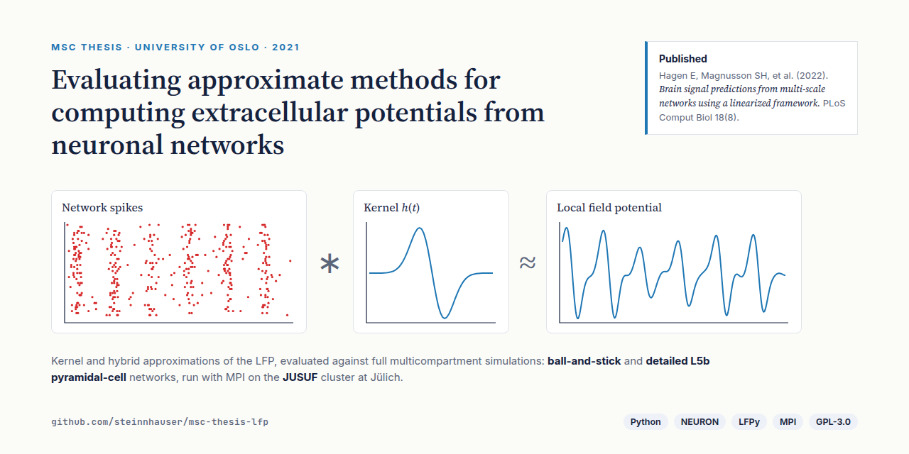
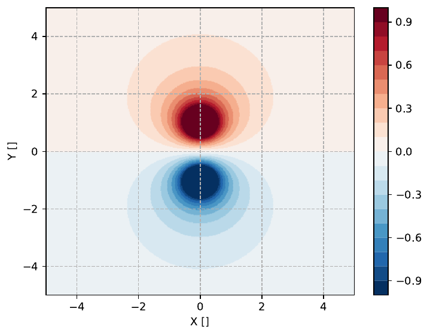
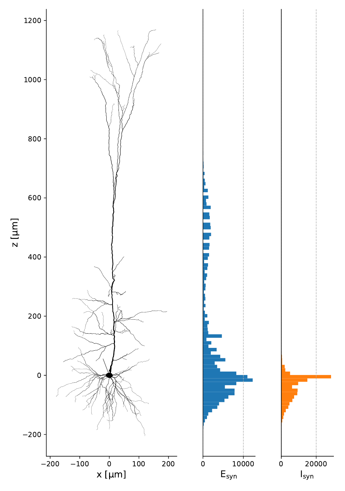
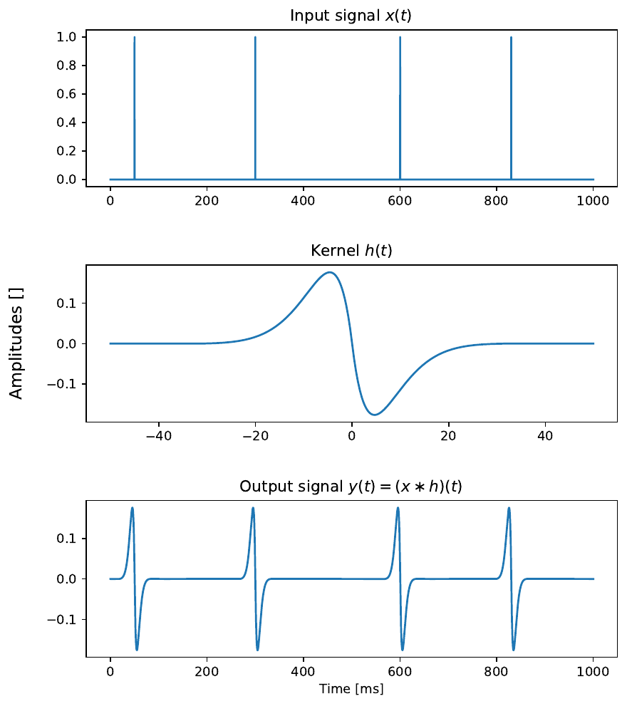
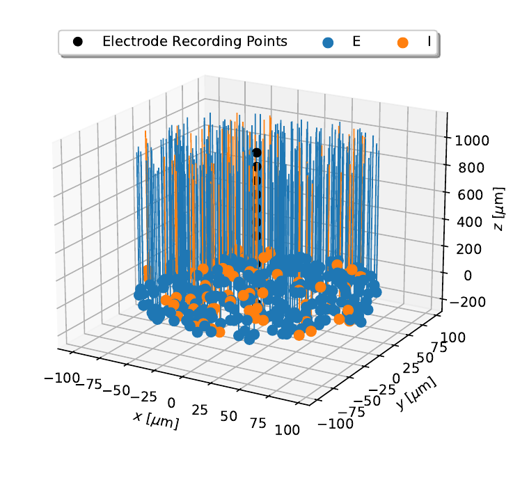
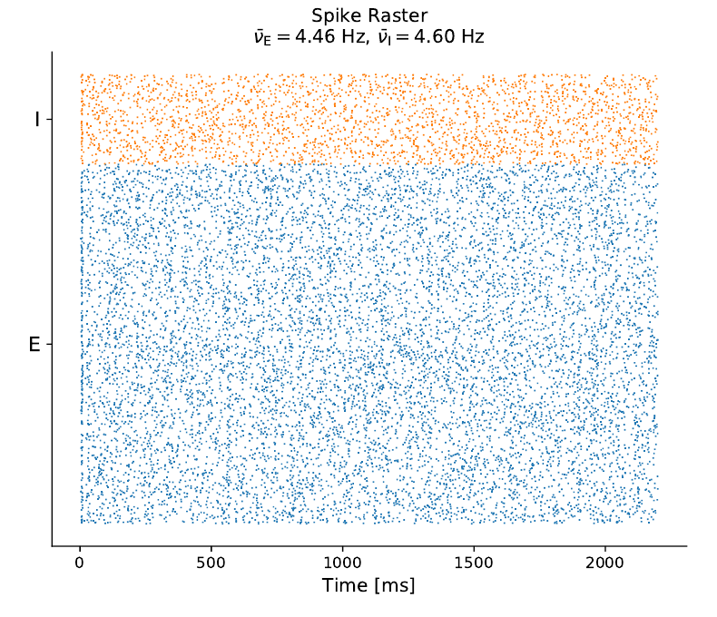
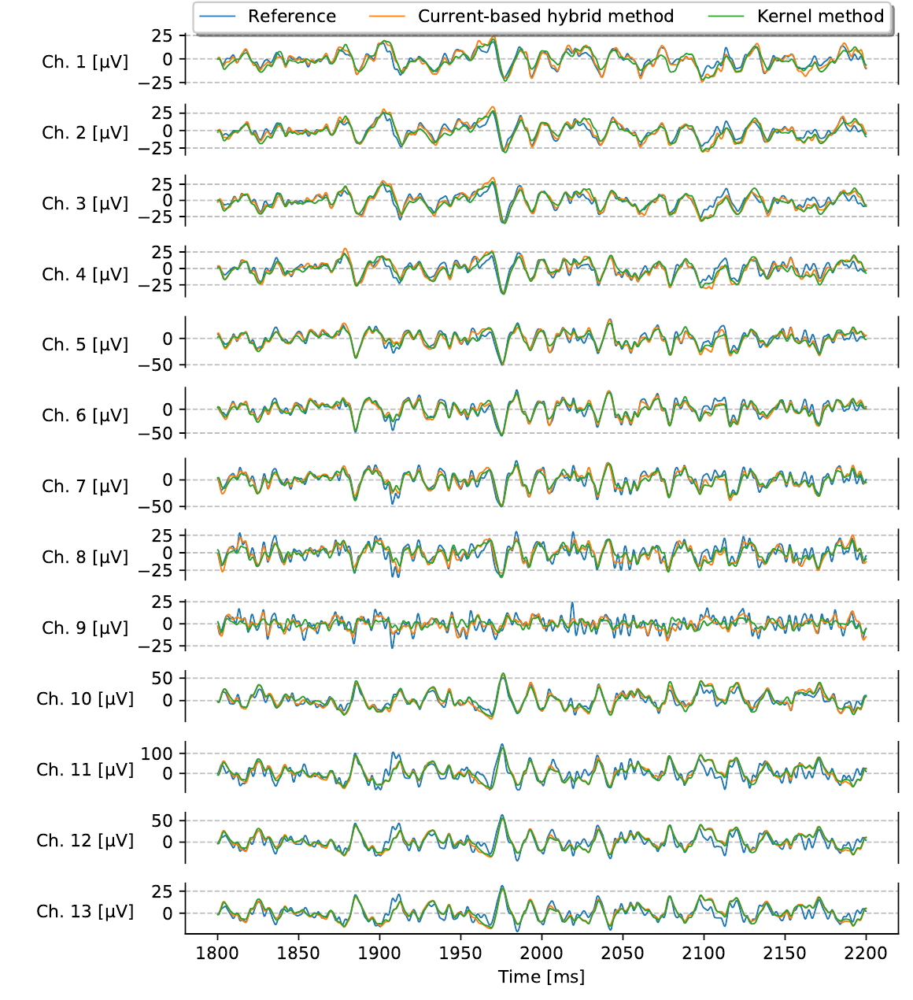
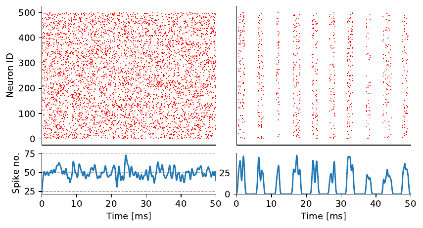
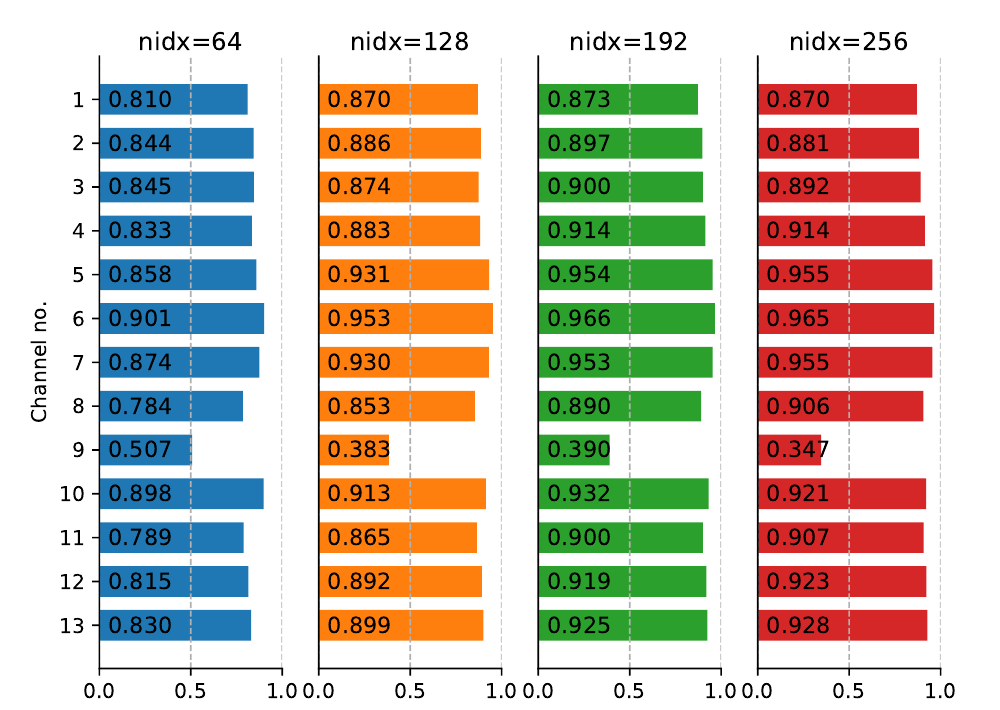
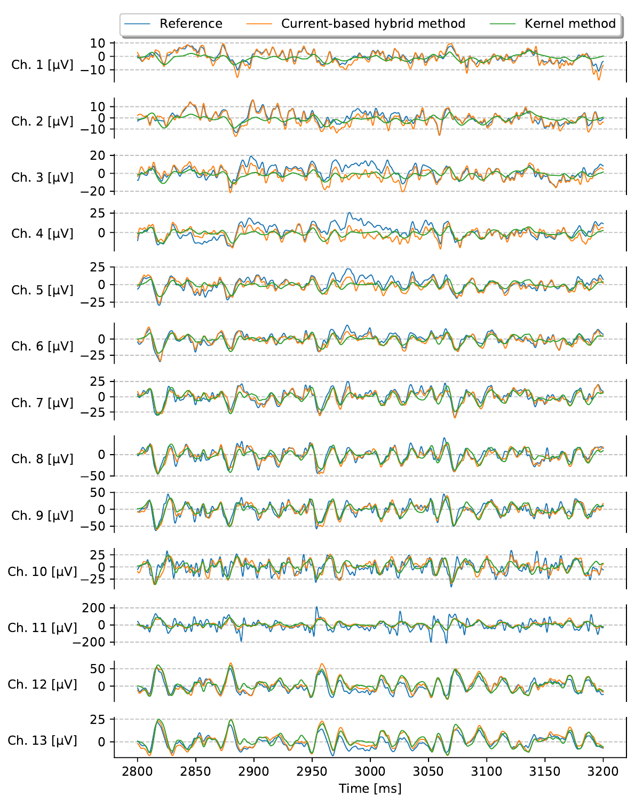

# Evaluating Approximate Methods for Computing Extracellular Potentials from Neuronal Networks

[](thesis.pdf)
[](https://doi.org/10.1371/journal.pcbi.1010353)
[](LICENSE)



Code for my MSc thesis in Computational Science (Physics) at the University of Oslo. The thesis asks how accurately two cheap, linear methods predict the brain signal that electrodes measure, the **local field potential (LFP)**. Each method is compared against full multicompartment simulations of the same networks.

|                 |                                                                                                                                                                                                              |
| --------------- | ------------------------------------------------------------------------------------------------------------------------------------------------------------------------------------------------------------ |
| **Degree**      | MSc in Computational Science: Physics, University of Oslo, 2021 (grade A)                                                                                                                                    |
| **Supervisors** | Gaute T. Einevoll and Espen Hagen                                                                                                                                                                            |
| **Publication** | Hagen E, Magnusson SH, et al. (2022). [_Brain signal predictions from multi-scale networks using a linearized framework._](https://doi.org/10.1371/journal.pcbi.1010353) PLoS Comput Biol 18(8): e1010353 |
| **Stack**       | Python, NEURON, LFPy (patched), MPI (mpi4py), NumPy, SciPy, h5py                                                                                                                                             |
| **Compute**     | Ball-and-stick networks on a laptop (4 threads). The biophysically detailed network on the JUSUF cluster at the Jülich Supercomputing Centre (512 threads)                                                   |

## Key findings

- **Both linear methods reproduce the ground-truth LFP** of a 1,280-neuron ball-and-stick network closely. The hybrid scheme is slightly more accurate. The kernel method runs in **under 3 minutes instead of over 2 hours** for the hybrid scheme.
- **Synchronous network states do not break the kernel method.** Correlation with the ground truth _improves_ as the external drive grows to 4× baseline. The amplitude is overestimated, however, by up to 2×.
- **A biophysically detailed layer 5b pyramidal-cell network is the hardest case.** Dendritic filtering smooths the kernels far from the synapses, so the hybrid scheme beats the kernel method there. Both still capture the signal well overall, which supports linearised LFP prediction for large-scale networks.

---

## The problem: the LFP is expensive to compute

<p align="center">
  
  &nbsp;
  
</p>
<p align="center"><sub>Left: a current source and sink form a dipole, the basic building block of extracellular potentials. Right: the Hay L5b pyramidal cell used in the detailed network, with the depth distribution of its excitatory and inhibitory synapses.</sub></p>

Every neuron's transmembrane currents add up to the extracellular potential, and the LFP is its low-frequency part. Computing it exactly means simulating every neuron with its full dendritic morphology (_multicompartment_ models), which gets very expensive for large networks. Point-neuron networks are cheap, but have no morphology, so they produce no LFP on their own.

## Two shortcuts: the hybrid scheme and the kernel method

<p align="center">
  
</p>
<p align="center"><sub>The core idea of the kernel method: spikes convolved with a kernel give the extracellular signal.</sub></p>

Both methods were introduced by [Hagen et al. (2016)](https://doi.org/10.1093/cercor/bhw237):

- **Hybrid scheme.** Spike times from the network are replayed as synaptic input onto _unconnected_ multicompartment neurons, whose currents give the LFP. The thesis compares a conductance-based and a current-based variant.
- **Kernel method.** For each pair of populations, a kernel $H_{YX}(\mathbf{r}, t)$ is computed once: the average LFP response at electrode position $\mathbf{r}$ to a spike in presynaptic population $X$, via its synapses onto population $Y$. The LFP is then a sum of convolutions with the population firing rates $\nu_X$:

$$\phi(\mathbf{r}, t) \approx \sum_{X,Y} \left(\nu_X * H_{YX}\right)(\mathbf{r}, t)$$

## The networks

<p align="center">
  
  &nbsp;
  
</p>
<p align="center"><sub>The recipe ball-and-stick network: 25% of its 1,280 excitatory (E) and inhibitory (I) neurons around the 13-channel electrode, and its spike raster.</sub></p>

- **Recipe ball-and-stick network** ([`recipeBaS/`](recipeBaS/)). 1,280 excitatory and inhibitory neurons with simplified morphologies, recorded by an electrode with 13 channels along the cortical depth. Its full simulation is the ground truth.
- **Biophysically detailed network** ([`detailedHay/`](detailedHay/)). Excitatory neurons use the [Hay et al. (2011)](https://modeldb.science/139653) L5b pyramidal cell, with active dendrites and many ion channels, and inhibitory neurons use shortened ball-and-stick cells.

Each folder holds the same pipeline: `01` model setup, `02` kernel generation, `03` ground-truth network simulation, `04`–`06` hybrid and kernel reconstructions, run by `sim.sh` with MPI.

## Results

### 1. Ball-and-stick network: both methods follow the ground truth

<p align="center">
  
</p>

The reference (blue), current-based hybrid (orange) and kernel (green) LFPs overlap closely on all 13 channels. The main deviations are near the somata, where fast action-potential currents add nonlinear contributions that linear methods cannot capture by design.

### 2. Synchrony: the kernel method holds up

<p align="center">
  
  &nbsp;
  
</p>
<p align="center"><sub>Left: asynchronous versus synchronous network activity. Right: Pearson correlation between the reference and kernel LFP per channel, as the external drive grows from the baseline (nidx = 64) to 4× (nidx = 256).</sub></p>

The expectation was that synchronous activity would break the linear approximation. Instead, increasing the external drive, or tuning synaptic weights towards synchrony, _raised_ the correlation on most channels, to above 0.9. The mean squared error grew at the same time, and the kernel prediction's amplitude reached up to twice the ground truth. When amplitude matters, synchronous networks need another approach.

### 3. Detailed Hay-cell network: the hardest case

<p align="center">
  
</p>

With realistic pyramidal cells, both methods lose accuracy. The effect is strongest on channels 1–3, which are farthest from the synapses at the somata. There, intrinsic dendritic filtering turns the kernels into slow, low-amplitude responses (green). The hybrid scheme (orange) keeps more of the variability, because it activates individual synapses rather than averaging over whole populations. Overall, both methods remain good approximations.

---

## Repository layout

| Path                         | Contents                                                                                                                                            |
| ---------------------------- | --------------------------------------------------------------------------------------------------------------------------------------------------- |
| `recipeBaS/`                 | Ball-and-stick network: model setup, kernel generation, population simulation, and hybrid and kernel reconstructions (`01`–`06` scripts, `sim.sh`) |
| `detailedHay/`               | The same pipeline for the detailed Hay L5b pyramidal cell network                                                                                   |
| `detailedHay/L5bPCmodelsEH/` | Hay et al. (2011) L5b pyramidal cell model, from [ModelDB #139653](https://modeldb.science/139653)                                                  |
| `misc/`                      | Scripts for the illustrative figures in the thesis (convolution, dipoles, Fourier, spike rasters)                                                   |
| `masters_utils/`             | Installable helper package (`utils.plotter`, `utils.misc`, `utils.tester`) used by the scripts                                                      |
| `lfpy-patch/`                | The small patch to LFPy v2.1.1 that the thesis relies on (see its [README](lfpy-patch/README.md))                                                   |
| `docs/`                      | README figures and [`make_figures.sh`](docs/make_figures.sh), which renders them from `thesis.pdf` and `misc/`                                      |
| `thesis.pdf`                 | The thesis                                                                                                                                          |

## Running

Versions used in the thesis (section 3.7.2): Python 3.8.5, NEURON 7.8.2, numpy 1.20.1, SciPy 1.6.1, Cython 0.29.22,
mpi4py 3.0.3, h5py 3.1.0, pandas 1.2.2, matplotlib 3.3.4, and LFPy 2.1.1 with the patch in `lfpy-patch/`.

```bash
# 1. LFPy with the thesis patch
git clone https://github.com/LFPy/LFPy.git && cd LFPy
git checkout 49f819f && git apply ../msc-thesis-lfp/lfpy-patch/lfpy-v2.1.1-thesis.patch
pip install . && cd ..

# 2. Thesis utilities
pip install -e msc-thesis-lfp/masters_utils

# 3. Compile NEURON mechanisms and run, e.g. the ball-and-stick network
cd msc-thesis-lfp/recipeBaS
nrnivmodl
./sim.sh 12.8 1 run0    # population scale, external drive scale, run name
```

For `detailedHay/`, also run `nrnivmodl` inside `detailedHay/L5bPCmodelsEH/mod/`.

## History

This repository combines the original `linearLFP` and `linearLFP_utils` repositories, with all their commits kept.
The thesis PDF (section 3.7.1) links to those repositories and to an LFPy fork, which are no longer public. Their contents live here:
`linearLFP` at the root (its old URL redirects here), `linearLFP_utils` in `masters_utils/`, and the fork's changes in `lfpy-patch/`.

## Credits

- Supervisors: Gaute T. Einevoll and Espen Hagen
- [LFPy](https://github.com/LFPy/LFPy) (GPL-3.0). `exp2isyn.mod` is taken from LFPy's examples.
- Hay E, Hill S, Schürmann F, Markram H, Segev I (2011). _Models of neocortical layer 5b pyramidal cells capturing a wide range of dendritic and perisomatic active properties._ PLoS Comput Biol 7(7): e1002107.

## License

The code in this repository is licensed under the [GNU General Public License v3.0](LICENSE). This includes the thesis scripts, `masters_utils/` and the LFPy patch, consistent with LFPy's own GPL-3.0 license.

Not covered by that license:

- `thesis.pdf`, © 2021 Steinn Hauser Magnússon, all rights reserved. The README figures cropped from it in `docs/assets/` share that copyright.
- `detailedHay/L5bPCmodelsEH/`, the Hay et al. (2011) model from ModelDB, which remains under its authors' terms.
